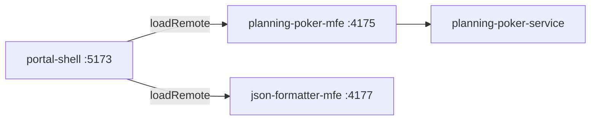

# 🏛️ Coelho Labs · Portal Shell

> O host de Micro Frontends do **Coelho Labs** — um hub de ferramentas inteligentes, rápidas e minimalistas para a produtividade e a colaboração de times de tecnologia.

[](https://react.dev)
[](https://www.typescriptlang.org)
[](https://vite.dev)
[](https://tailwindcss.com)
[](https://module-federation.io)
[](https://github.com/coelho-labs/portal-shell/actions/workflows/ci-cd.yml)

## 🌐 O que é a [Coelho Labs](https://coelho-labs.vercel.app)

A [**Coelho Labs**](https://coelho-labs.vercel.app) é um laboratório de produtos digitais focado em ferramentas para equipes de tecnologia. O ecossistema é organizado como um conjunto de **Micro Frontends independentes**, com desenvolvimento e deploy desacoplados, unidos por contratos explícitos de Module Federation.

Este repositório é a **casca** desse ecossistema. Ele não contém regras de negócio: seu papel é oferecer layout global, roteamento, tema, carregamento de remotes e uma experiência visual consistente entre as ferramentas.

## 🧩 O ecossistema

| Repositório | Papel | Integração com o Host |
| --- | --- | --- |
| **portal-shell** (este) | Host MFE / casca do ecossistema | — |
| **planning-poker-mfe** | Feature MFE de Planning Poker (salas, votação, sugestões com IA) | `loadRemote` em `/planning/*` · dev `:4175` |
| **json-formatter-mfe** | Utility MFE de JSON 100% client-side (formatar, validar, minificar) | `loadRemote` em `/json-formatter/*` · dev `:4177` |
| **planning-poker-service** | Backend FastAPI (REST + WebSocket + LLM) | consumido pelo `planning-poker-mfe` |

> Parte dos repositórios do ecossistema é privada.

## 🧭 O que este repositório faz

- Orquestra remotes via **Module Federation** (`mf-manifest.json` + DTS).
- Mantém o **layout global**: header com navegação, `<main>` e footer.
- Fornece o **roteamento unificado** com React Router 7.
- É dono do **tema em runtime** (`.dark`, `colorScheme` e `coelho-theme`).
- Exibe estados de carregamento com `Suspense` + componente `Loading`.
- Compartilha `react`, `react-dom` e `react-router-dom` como singletons.

**Não pertence a este repo:** regras de negócio, WebSocket, IA, backend e analytics.

## 🗺️ Rotas

| Rota | Conteúdo |
| --- | --- |
| `/` | Home com o catálogo de ferramentas |
| `/planning/*` | `planning-poker-mfe` |
| `/json-formatter/*` | `json-formatter-mfe` |

## 🚀 Rodando localmente

Pré-requisito: Node compatível com o campo `engines` do `package.json`.

```bash
npm install
cp .env.example .env
npm run dev
```

O Host sobe em `http://localhost:5173` (porta padrão do Vite). As rotas remotas exigem os MFEs correspondentes em execução:

```bash
# planning-poker-mfe
npm run dev   # http://localhost:4175

# json-formatter-mfe
npm run dev   # http://localhost:4177
```

### Variáveis de ambiente

| Variável | Uso |
| --- | --- |
| `VITE_PLANNING_POKER_ENTRY` | entry/manifest do `planning-poker-mfe` |
| `VITE_JSON_FORMATTER_ENTRY` | entry/manifest do `json-formatter-mfe` |

### Scripts

| Comando | O que faz |
| --- | --- |
| `npm run dev` | Vite em desenvolvimento (`:5173`) |
| `npm run build` | typecheck dos projetos app/node + build de produção |
| `npm run preview` | preview do build (`:4173`) |
| `npm run lint` | ESLint |
| `npm run types` | typecheck do app |
| `npm run test` | Vitest (unitários + integração) |
| `npm run test:watch` | Vitest em modo watch |
| `npm run test:types` | typecheck dos testes |
| `npm run test:mutation` | Stryker incremental |
| `npm run test:mutation:full` | Stryker completo (`--force`, sem cache incremental) |

## 🧱 Arquitetura MFE



Contratos principais:

- Remotes são registrados na forma de objeto, com `type: "module"`, `name` igual à chave e `entry` apontando para `mf-manifest.json`.
- O Host consome via `loadRemote()` + `React.lazy`, sempre dentro de `Suspense`.
- `react`, `react-dom` e `react-router-dom` são singletons — duplicá-los quebra o runtime.
- Remotes com rota expõem `./RemoteAppEntry` com `<Routes>`, **sem** `<BrowserRouter>` e **sem** `<main>`.

## 🎨 Design system e tema

- **Tailwind v4** CSS-first, com tokens oklch em `src/index.css`.
- **shadcn/ui sobre Base UI** (`@base-ui/react`), usando a prop `render` no lugar de `asChild`.
- Componentes de UI em `src/components/ui/`; alias `@` → `src/`.
- O **Host é dono do tema**: alterna `.dark` no `<html>`, persiste em `coelho-theme` e evita FOUC com script inline no `index.html`.
- Remotes replicam os tokens e seguem o `.dark` controlado pelo Host.

## 🧪 Qualidade

- **Vitest + Testing Library** com jsdom.
- Testes co-localizados (`*.test.ts`/`*.test.tsx`) no padrão **Given / when / then**.
- Cobertura de mutação com **Stryker** e gate em **90%** (`thresholds.break`).
- Fora do escopo de mutação: `src/components/ui/**`, `src/lib/utils.ts`, `src/test/**` e configs.

```bash
npm run test
npm run test:types
npm run test:mutation:full
```

## 📁 Estrutura

```text
src/
  components/          # shell + componentes shadcn/ui
  hooks/use-theme.ts   # tema cross-MFE
  pages/home/          # Home e catálogo
  test/                # setup, polyfills e tipos de teste
  App.tsx              # layout + rotas + remotes
  main.tsx             # entrypoint
module-federation.config.ts
stryker.config.json
vitest.config.ts
```

## 🤝 Contribuição

Este projeto é mantido de forma independente. Leia o [CONTRIBUTING.md](./CONTRIBUTING.md) antes de abrir qualquer contribuição.

## 📬 Contato

Desenvolvido por **Herivelton Coelho**.

- [Coelho Labs no GitHub](https://github.com/coelho-labs)
- [GitHub de Herivelton Coelho](https://github.com/hericoelho)
